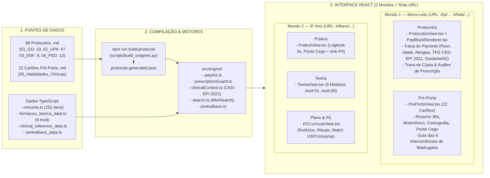

# Arquitetura do Cockpit Editável - Novo-PEP

Documentação oficial da arquitetura do **Novo-PEP** (React 19 + TypeScript + Tailwind v4 + Vite PWA).

---

## 1. Arquitetura em 3 Camadas

O diagrama abaixo ilustra o fluxo completo do sistema, desde as fontes de dados e protocolos em Markdown até a interface React reativa.



---

## 2. Árvore Hierárquica de Componentes e Modais

```text
src/
├── App.tsx
├── components/
│   ├── CommandPalette.tsx       (Ctrl+K)
│   ├── ShortcutsHelp.tsx        (?)
│   ├── QuickCaptureModal.tsx    (Captura rápida de notas/pontos cegos)
│   ├── BackupModal.tsx          (Exportação/Importação de dados e localStorage)
│   └── layout/
│       ├── Navbar.tsx
│       └── Sidebar.tsx
├── views/
│   ├── ProtocolosView.tsx
│   ├── PrePortaView.tsx
│   ├── PraticaView.tsx
│   ├── TeoriaView.tsx
│   └── R1CurriculoView.tsx
└── engine/
    ├── pepAst.ts
    ├── prescriptionGuard.ts
    ├── clinicalContext.ts
    ├── search.ts
    └── central6ano.ts
```

---

## 3. Mapa de Interações e Módulos Principais

| Módulo / Componente | Função Principal | Tecnologias / Motores Envolvidos |
| :--- | :--- | :--- |
| **CommandPalette** (`Ctrl+K`) | Busca global rápida de protocolos, drogas REMUME e conteúdos clínicos. | `search.ts` (MiniSearch) |
| **ShortcutsHelp** (`?`) | Guia rápido de atalhos de teclado do sistema. | React State / Tailwind v4 |
| **QuickCaptureModal** | Registro rápido de observações beira-leito e pontos cegos com proteção PII. | `piiGuard.ts`, LocalStorage |
| **BackupModal** | Gestão de dados locais, backup e restauração do estado do cockpit. | File API / JSON |
| **ProtocolosView** | Exibição e interatividade de guias clínicos com blocos editáveis e cópia segura. | `PepBlockRenderer.tsx`, `clinicalContext.ts` (CKD-EPI 2021) |
| **PrePortaView** | Acesso rápido aos 22 cartões de emergência e intercorrências de plantão. | Markdown Engine / UI Cards |
| **PraticaView** | Logbook dinâmico de plantão com métricas de autonomia e segurança PII. | `central6ano.ts`, `piiGuard.ts` |
| **TeoriaView** | Acompanhamento dos 9 módulos de formação teórica do internato. | `formacao_teorica_data.ts` |
| **R1CurriculoView** | Planejamento de rodízios, rituais e matriz unificada de residência médica. | Dados estruturados TS |
